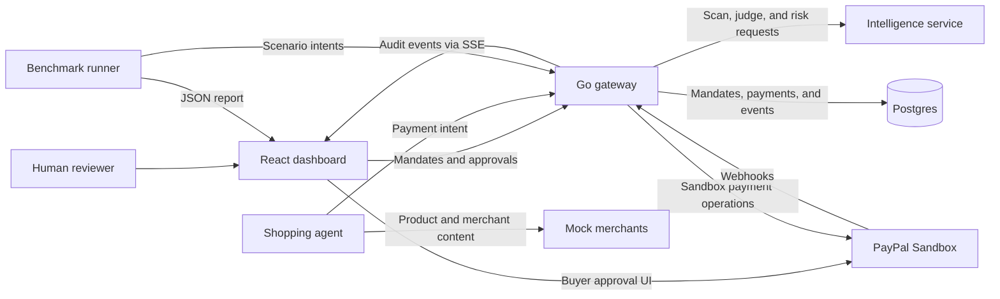

# AgentGuard

AgentGuard is a payment firewall prototype for AI shopping agents and PayPal, with signed spending limits, human review, and a live audit trail.

**Available on `ritika`** — the dashboard runs as a browser-only demo with simulated payment decisions. The repository also contains shared contracts, a Render Blueprint, and a sandbox seed script. The server components shown below are the intended integration topology. <!-- VERIFY -->

## Problem

An agent can find a plausible product and still choose the wrong merchant, exceed a user's authority, or follow instructions embedded in merchant content. A payment system needs to check what the user authorized, why the agent chose the purchase, and how much risk the request carries. The team also needs a record that explains what happened after the decision.

## Solution

The payment policy defines four checks. The browser demo illustrates their outcomes with simulated events. <!-- VERIFY -->

| Layer | Responsibility |
| --- | --- |
| Signed mandate | Verify the human's Ed25519 signature, agent identity, validity window, amount caps, and merchant and category allowlists. |
| Injection scan | Check merchant content for instructions that try to override the purchase task. |
| Intent judge | Compare the proposed purchase with the user's task and record the verdict and rationale. |
| Risk engine | Evaluate amount and behavior signals, including repeated partial purchases, and raise a review or block when warranted. |

## Architecture

The diagram shows the planned full-stack connections. The dashboard stub exercises the browser routes without starting the other components. <!-- VERIFY -->



See [architecture](docs/architecture.md) and the [API and event reference](docs/api.md).

## How a payment flows

1. A reviewer defines the mandate, approves a sandbox order, and signs the mandate in the browser. Stub mode simulates the approval.
2. In the planned live flow, the agent sends a payment intent with the signed mandate, merchant, items, amount, source context, and idempotency key. <!-- VERIFY -->
3. The gateway applies the four checks and records `allow`, `step_up`, or `block`. A step-up goes to the human approvals inbox. PayPal and webhook processing are part of the live integration handoff. <!-- VERIFY -->
4. The dashboard projects the event stream into the Live Ledger and payment timelines. The demo scenario buttons use the same dashboard stream with simulated events.

## Quick start

### Run the dashboard from a fresh clone

Install Git and Node.js 22.12+ with npm. Use a current browser with Web Crypto support. Localhost provides the secure browser context for demo signing.

Run these commands in PowerShell.

```powershell
git clone --single-branch --branch ritika https://github.com/gundatharuntej2006-hue/paypal.git agentguard
Set-Location agentguard/dashboard
Copy-Item .env.example .env.local
npm.cmd ci
npm.cmd run dev -- --host localhost --port 5173 --strictPort
```

On macOS or Linux, use `cd agentguard/dashboard`, `cp .env.example .env.local`, and `npm` in place of `npm.cmd`.

Open [http://localhost:5173](http://localhost:5173). The default `VITE_USE_STUB=true` loads sample mandates and payments into the browser. No credentials, database, or seed command are needed.

1. In **Mandates**, enter a task such as “Restock supplies for the demo”, continue to PayPal, choose **Simulate PayPal approval**, then **Sign and save mandate**.
2. In **Live Ledger**, select the new mandate under **Run demo scenario**. Run **Happy path** and **Poisoned page** to see an allow and a block. **Budget splitting** streams several related requests.
3. Open a ledger row, then **Open full timeline**. The **Approvals** page has seeded step-up requests. Demo records reset on a full page reload.

### Full sandbox stack

The commands below mirror the service paths and entry points in [render.yaml](render.yaml). Use them after the teammates' services land and their configuration is confirmed. The current branch has no gateway, intelligence service, agent, mock merchant service, or benchmark runner to start locally. <!-- VERIFY -->

The proposed stack requires Go, Python 3, Postgres, and a PayPal Sandbox application and buyer account. Confirm runtime versions when the service manifests land. <!-- VERIFY -->

1. Provision Postgres, set `DATABASE_URL`, and apply the gateway's migrations. Confirm migration, agent, merchant, and benchmark-runner commands with the owning teammates. <!-- VERIFY -->
2. In a terminal at the repo root, start intelligence using the Blueprint's expected Python layout. <!-- VERIFY -->

   ```powershell
   Set-Location intelligence
   python -m venv .venv
   ./.venv/Scripts/python.exe -m pip install -r requirements.txt
   ./.venv/Scripts/python.exe -m uvicorn app.main:app --host 127.0.0.1 --port 8000
   ```

3. In a second terminal at the repo root, supply the sandbox gateway variables below and start the proposed Go entry point. <!-- VERIFY -->

   ```powershell
   Set-Location gateway
   $env:PORT = '8080'
   $env:INTELLIGENCE_HOSTPORT = '127.0.0.1:8000'
   go run .
   ```

4. From the repo root, seed the running sandbox with a signed, approved demo mandate kept outside Git. Follow the [seed prerequisites](docs/deployment-checklist.md#manual-seed-trigger). The script was exercised against a local fixture. Its live gateway behavior is pending. <!-- VERIFY -->

   ```powershell
   $env:DEMO_GATEWAY_URL = 'http://localhost:8080'
   $env:DEMO_SANDBOX = '1'
   node scripts/demo/seed.mjs path/to/signed-sandbox-mandate.json
   ```

5. Set `VITE_USE_STUB=false` and the sandbox `VITE_PAYPAL_CLIENT_ID` in `dashboard/.env.local`. Run the dashboard command from the quick start, then open [Live Ledger](http://localhost:5173/ledger). Verify startup, principal enrollment, and PayPal approval against the live gateway. <!-- VERIFY -->

## Hosted demo

**Hosted URL** `https://<published-dashboard-host>` <!-- VERIFY -->

Use the [Render setup guide](docs/render-setup.md) and [private-browser deployment checklist](docs/deployment-checklist.md). The checklist includes a standalone static-site option for the browser-only demo.

## Benchmark results

Open the [local Benchmark dashboard](http://localhost:5173/benchmark) or inspect the [labeled sample report](dashboard/src/benchmark/benchmark-report.sample.json). A measured run can be published at `/benchmark-report.json` or served by `GET /v1/benchmark/report` using the [report schema](contracts/benchmark-report.schema.json). <!-- VERIFY -->

| Metric | Measured run |
| --- | --- |
| Run ID and timestamp | Pending |
| Attack and benign scenario counts | — |
| Overall block rate | — |
| False-positive rate | — |
| Median and p95 latency | — |
| LLM-only vs. full-stack block rate | — |

## Tools and APIs used

| Tool | Use on this branch |
| --- | --- |
| React, TypeScript, Vite, React Router | Browser dashboard, typed contracts, build, and navigation. |
| Web Crypto | Generates demo Ed25519 keys and signs and verifies canonical mandate JSON in the browser. |
| PayPal JavaScript SDK (`@paypal/paypal-js`) | Loads PayPal Buttons in live mode. Mandate consent uses `createOrder` to request an order from the gateway and `onApprove` to obtain the order ID. Step-up checkout can use a gateway-provided order ID with SDK Buttons or a PayPal approval link. The dashboard hands the order ID back to the gateway. |
| AG Grid Community | Renders the streaming ledger and benchmark scenario table. Dashboard controls provide exact-value filters and ledger grouping. |
| Recharts | Displays class block rates, catching layers, and the ablation comparison. |
| Render Blueprint | Defines the sandbox web services, managed Postgres, static dashboard, branch, health checks, and environment bindings. |
| Vitest | Covers mandate validation and signatures, ledger event projection, and payment timeline order. |
| Postman | Checks the proposed gateway routes, HTTP statuses, and response contracts against a local fixture. |

The PayPal REST API inventory is pending a code audit because the gateway PayPal client is absent from this checkout. Live checkout has been exercised with a local fixture. <!-- VERIFY -->

AI model IDs and APIMatic usage are pending verification. Record the model IDs, their roles, and any APIMatic-generated clients once the service code can be inspected. <!-- VERIFY -->

## Project structure

```text
.
├── contracts/          Shared JSON examples and benchmark report schema
├── dashboard/          React app, stub and live clients, and tests
│   └── src/            Mandates, ledger, detail, approvals, benchmark, and demo
├── docs/               Architecture, API reference, and deployment handoff
├── scripts/demo/       Sandbox seed and payment replay command
├── render.yaml         Render Blueprint
└── LICENSE             MIT license
```

## Environment variables

Copy [dashboard/.env.example](dashboard/.env.example) to `dashboard/.env.local` for local settings. Restart Vite after changes. Render applies `VITE_` values at build time and the browser can read them.

| Dashboard variable | Default or purpose |
| --- | --- |
| `VITE_USE_STUB` | `true` by default. Set `false` for the live client. |
| `VITE_GATEWAY_URL` | Gateway origin for health, API, and events. Leave blank in standalone stub mode. The live client defaults to `http://localhost:8080`. |
| `VITE_PAYPAL_CLIENT_ID` | Public PayPal sandbox client ID for browser checkout. |
| `VITE_DEMO_MODE` | Set `true` to show the sandbox scenario controls in live mode. Stub mode always shows them. |
| `VITE_DEMO_RUN_URL` | Optional override. Defaults to the gateway URL plus `/v1/demo/run`. |
| `VITE_BENCHMARK_SOURCE` | `auto` prefers a static report, then a configured gateway. `static` or `gateway` selects one source. |
| `VITE_BENCHMARK_REPORT_URL` | Defaults to `/benchmark-report.json`. |

The server settings come from the Blueprint. Confirm their names and accepted values when the service code lands. <!-- VERIFY -->

| Scope | Variables | Purpose |
| --- | --- | --- |
| Gateway | `PORT`, `DATABASE_URL`, `INTELLIGENCE_HOSTPORT` | HTTP binding, Postgres connection, and intelligence host and port. |
| Gateway | `CORS_ALLOWED_ORIGINS` | Exact dashboard origin, including scheme and port when present. |
| Gateway | `PAYPAL_BASE_URL`, `PAYPAL_CLIENT_ID`, `PAYPAL_CLIENT_SECRET`, `PAYPAL_WEBHOOK_ID` | Sandbox base URL and credentials. Keep the secret on the server. |
| Gateway | `MANDATE_PUBLIC_KEY`, `MANDATE_PRIVATE_KEY` | Proposed gateway key configuration. Confirm key formats and enrollment. |
| Intelligence | `PORT`, `LLM_API_KEY` | HTTP binding and server-side provider key. |
| Seed command | `DEMO_GATEWAY_URL`, `DEMO_SANDBOX` | Sandbox gateway URL and explicit sandbox opt-in (`1`). |

## Testing

From `dashboard/` after `npm.cmd ci`:

```powershell
npm.cmd run typecheck
npm.cmd run lint
npm.cmd test
npm.cmd run build
npm.cmd run preview -- --host localhost --port 4173 --strictPort
```

Open [http://localhost:4173](http://localhost:4173) for the production build. Run the [fresh-browser walkthrough](docs/deployment-checklist.md#fresh-browser-acceptance) to verify signing, streamed decisions, and the timeline.

### Gateway contract checks with Postman

Import the [collection](postman/AgentGuard.postman_collection.json) and [local environment](postman/AgentGuard.local.postman_environment.json) into Postman. Select **AgentGuard Local Sandbox**, set the gateway URL, and set the history payment ID to a known record. Start with **Read-only checks**. Open **Streaming (manual)** separately for SSE because the live stream can remain open.

Enable sandbox writes explicitly and provide signed mandate and payment-intent JSON from your sandbox. Use separate pending payment IDs for approval and rejection. Provide the approved PayPal order ID for checkout-backed approval. The unsigned webhook request expects a rejection. Keep sandbox credentials and signed payloads out of shared exports.

The collection targets the [proposed gateway contract](docs/api.md). It was tested against a local HTTP fixture. Live gateway verification is pending.

## Troubleshooting

| Symptom | Check |
| --- | --- |
| `npm` is blocked by PowerShell | Use `npm.cmd` as shown. Check `node --version` and rerun `npm.cmd ci`. |
| The requested local port is in use | Stop the process using port 5173 or 4173, or choose an unused port and open the URL Vite prints. |
| The live dashboard stays on “Waking up the server” | Check the gateway `/health` response and exact CORS origin. Use `VITE_USE_STUB=true` to run the standalone dashboard. |
| A direct route returns 404 on a static host | Rewrite `/*` to `/index.html`. |
| A benchmark still shows sample data | Verify the configured source serves a valid JSON report. Static hosts may serve the SPA entry point when the report file is missing. |
| Browser signing fails | Use HTTPS or localhost in a current browser. The demo key is stored in the browser for that origin. |

## Team

- **Vivek** — gateway, mandate enforcement, payment policy, and core PayPal integration.
- **Atul** — intelligence checks, PayPal webhooks, and additional payment API integrations.
- **Tharun** — shopping agent, mock merchants, attacks, and benchmark runner.
- **Ritika** (credited as Rikita in the license) — dashboard, deployment, documentation, and submission.

## License

[MIT](LICENSE). See the [verification checklist](docs/readme-verify.md) for live integration and publication items.
